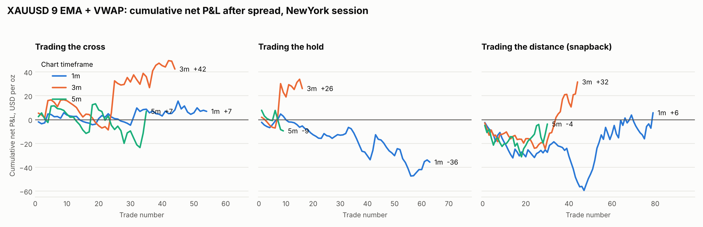

# 9 EMA + VWAP strategy backtest on XAUUSD

A mechanical backtest of the three setups in the "9 EMA + VWAP Strategy" guide
(trading the cross, the hold, and the snapback), applied to spot gold.

## Status: interim, small sample

The results below cover only **22 trading days** in two blocks
(11–22 Nov 2024 and 26 Oct–10 Nov 2026). The Dukascopy data feed throttled the
download hard, so the planned one-to-two-year test has not been run yet.
Treat every number here as indicative only. Re-running the script continues the
download from the local cache.

## Results (all figures in USD per oz, i.e. per 0.01 lot)

Net is after the real bid/ask spread (median 0.46). Gross is at mid prices.

| Setup | Trades | Net total | Gross total | Net per trade |
|---|---|---|---|---|
| Cross | 523 | −82.89 | +161.27 | −0.16 |
| Hold | 255 | +24.84 | +142.41 | +0.10 |
| Snapback | 470 | −167.51 | −57.34 | −0.36 |

These totals pool three timeframes (1m, 3m, 5m) and three sessions.

New York session only, which is the session the guide is written for:

| Setup | 1m | 3m | 5m |
|---|---|---|---|
| Cross | +6.95 (54 trades) | +42.42 (44) | +6.97 (35) |
| Hold | −35.62 (63) | +26.08 (16) | −9.42 (9) |
| Snapback | +5.79 (79) | +31.62 (44) | −3.68 (30) |



What the sample shows so far:

- **The spread decides the outcome.** The cross and hold setups are positive
  before costs and roughly break-even or negative after them. Average gross
  edge per trade (0.3–0.6) is about the size of the spread.
- **New York is the only session where the cross is positive on all three
  timeframes.** London and Tokyo are mostly negative after costs.
- **Longs carried the result.** Cross longs made +56.60 and shorts lost
  −139.49; gold rose from about 2,685 to 4,039 between the two blocks.
- **The snapback loses even before costs** outside New York.
- Win rates are low for the trend setups (20–40%), with winners two to four
  times the size of losers, as expected for a trailing exit.

Full per-cell statistics are in `results/summary.csv`, the long/short split in
`results/by_side.csv`, and every trade in `results/trades.csv.gz`.

## How the guide's rules were made mechanical

Signals use mid prices; fills use the next bar's open at the real ask (buys)
or bid (sells). No parameter was tuned.

| Rule | Implementation |
|---|---|
| 9 EMA | EMA(9) of closes, continuous across sessions |
| VWAP | Typical price weighted by Dukascopy volume, reset at each session open |
| Sessions | New York 09:30–16:00 ET (as in the guide), plus London 08:00–16:30 and Tokyo 09:00–15:00 local, since gold trades around the clock |
| Cross entry | EMA crosses VWAP; within 5 bars a candle closes beyond the EMA and the cross price; only 30–240 minutes after the open (the guide's 10:00–13:30 ET) |
| Hold entry | First 30 minutes; price beyond the open and both lines; a candle wicks into the EMA and closes back on the right side |
| Cross/hold exit | First candle that closes back through the EMA, or the session close |
| Snapback entry | Price was beyond the 2-sigma VWAP band in the last 5 bars, then a candle closes back over the EMA while still short of VWAP |
| Snapback exit | Target is VWAP; stop is the 10-bar swing extreme; if both are hit in one bar the stop is assumed first |

## Limits

- The guide's discretionary filters are **not** modelled: key levels, "volume
  showed up", SPY/QQQ agreement, news, and skipping chop days. The guide itself
  calls an unfiltered cross "a low-quality signal".
- Spot gold has no consolidated volume. VWAP here uses one broker's volume, so
  it will differ from a futures-based or TradingView VWAP.
- Spread is Dukascopy's; commission and slippage are not included.
- Each setup is tested as an independent book with one position at a time.

## Running it

```
pip install pandas numpy matplotlib
python3 backtest/xauusd_9ema_vwap.py --start 2025-11-11 --end 2026-11-10
python3 backtest/plot_equity.py                # New York equity chart
python3 backtest/xauusd_9ema_vwap.py --offline # use only days already cached
```

Not financial advice. A backtest is not a forecast.
